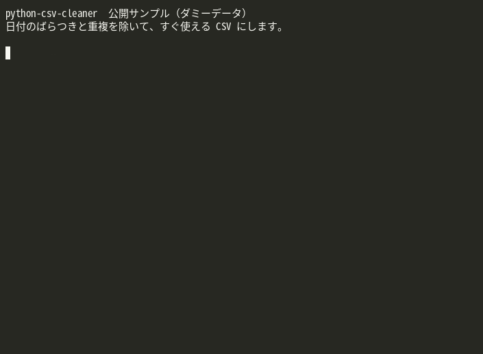

# python-csv-cleaner

日付のばらつきと重複を除いて、すぐ使えるCSVにします。



ダミーのサンプルに対して、実際のコマンドとテストを端末で実行した録画です（約11秒）。実在の顧客データは含まれていません。


手元の CSV を、重複削除・列の抽出・日付形式のそろえをして、新しい CSV に書き出すコマンドラインツールです。

**これは公開用のサンプルであり、受注成果物ではありません。** 実在の顧客データは含まれていません。サンプルの商品名はすべて架空です。

出品「PythonでCSVを自動整理します」の完成イメージを、第三者が手元で確認できるようにしたものです。

## 動作確認した環境

- OS: Linux（Debian 系）
- Python: 3.13

Windows と macOS では、このリポジトリの作成時点で実行確認をしていません。同じコマンドで動く見込みはありますが、両対応とは言いません。追加のライブラリは不要です（標準ライブラリのみ）。

## できること

- UTF-8（BOM 付きを含む）の CSV を読む
- `--key` で指定した列が同じ行を、先の行（または `--keep last` で後の行）だけ残す
- `--date-col` の列を `YYYY-MM-DD` にそろえる
- `--columns` で残す列と並び順を決める
- セル前後の空白を除く
- 完全に空の行を捨てる

## できないこと（このサンプルの範囲外）

- Web からの情報取得やスクレイピング
- Excel の数式や複数シートの処理
- 文字コードの自動推定（既定は UTF-8。違う場合は `--encoding` を指定する）

## 日付のルール

変換できた値は `YYYY-MM-DD` になります。

- `2024-01-05` / `2024/1/5` / `2024.07.08` のように、年が先頭の形式
- `2024年3月2日`
- 時刻が付いていても、日付だけを残す（`2024/07/08 09:15` → `2024-07-08`）
- `05/13/2024` のように年が末尾の場合は、**月/日/年** として扱います
- 先頭の数が 13 以上なら、日/月/年として扱います（`13/05/2024` → `2024-05-13`）
- **変換できない値は空にせず、警告を標準エラーに出して、元の値を残します**

あいまいな日付（例: `01/02/2024`）は月/日/年です。日/月/年で運用しているデータには向きません。

## 使い方

リポジトリのルートで:

```bash
python3 src/csv_cleaner.py   --input samples/input.csv   --output out/clean.csv   --key id   --date-col date   --columns id,name,date,category,note
```

成功すると終了コード `0`、入力や引数の不備は `1` です。`samples/output.csv` は、上と同じコマンドで作った期待結果です。

よく使うオプション:

| オプション | 意味 |
| --- | --- |
| `--keep first` / `--keep last` | 重複時に残す行（既定は `first`） |
| `--date-col col` | 日付列。複数回指定できる |
| `--columns a,b,c` | 残す列と順番 |
| `--encoding utf-8-sig` | 入力の文字コード（既定） |
| `--no-bom` | 出力を BOM なし UTF-8 にする。既定は Excel で開きやすいよう BOM 付き |

ヘルプ:

```bash
python3 src/csv_cleaner.py -h
```

## テスト

追加パッケージは不要です。

```bash
python3 -m unittest discover -s tests -v
```

## サンプルデータの内容

`samples/input.csv` には、次のような「よくある乱れ」を入れています。

- 先頭の BOM
- 名前の前後の空白
- `2024/1/5`、`05/13/2024`、`2024年3月2日`、時刻付き、変換できない文字列が混在した日付
- 同じ `id` の重複行
- 出力では捨てる余分な列 `unused`

## ライセンス

MIT License（`LICENSE` を参照）。
